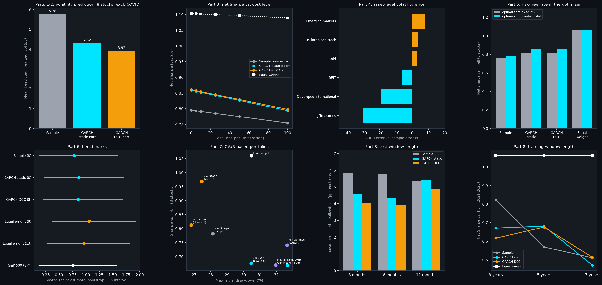
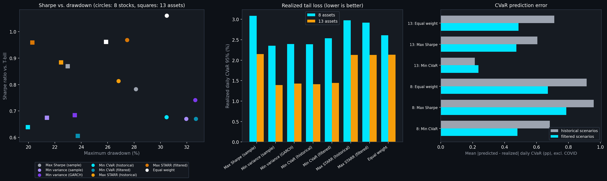
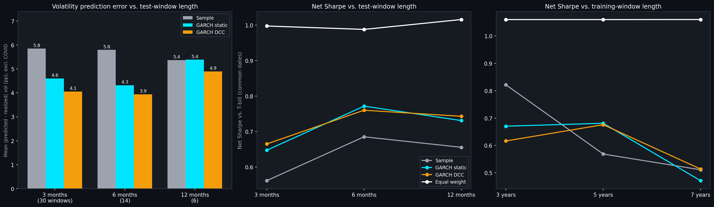

# Portfolio Optimization: Markowitz Theory with GARCH-Informed Risk
### Built on Real Market Data
**Ramith Vaid | NTU Singapore | Data Science & Artificial Intelligence**

---

## Overview

Standard Markowitz portfolio theory builds an efficient frontier from a single, fixed historical covariance matrix. This project asks where the risk estimate driving the optimization comes from, and whether a more responsive one leads to a better portfolio. It builds three covariance estimates and compares them out of sample:

- the **sample covariance** of the last five years of daily returns;
- a **GARCH-informed covariance**: each asset's volatility from a GARCH(1,1) model (the from-scratch implementation in the companion [volatility forecasting project](https://github.com/ramith001/volatility-forecasting)) combined with the historical correlation matrix, related to the Constant Conditional Correlation GARCH framework (Bollerslev, 1990);
- the same volatilities with a **DCC-GARCH** forecast of the correlation matrix (Part 2).

They are compared on how well they predict a portfolio's volatility over the next six months, and on the realized, net-of-cost performance of the Max Sharpe portfolios built from them, against equal-weight and S&P 500 benchmarks. Later parts add transaction costs, a wider asset universe, a time-varying risk-free rate, a CVaR-based objective and different window lengths. `SUMMARY.md` ties the parts together, and the chart below shows one result from each part.



**Asset universe:** 8 US large-cap stocks (JPM, AAPL, XOM, JNJ, PG, CAT, NEE, AMZN) across eight sectors for the main analysis, and from Part 4 also five ETFs (VNQ real estate, TLT long Treasuries, EFA developed international, EEM emerging markets, GLD gold), 13 assets in all. **Data:** Yahoo Finance daily prices from January 2014 to 13 October 2026 (3,214 trading days; the end date is pinned in each notebook), which gives 15 non-overlapping six-month test windows.

---

## Evaluation Design

**Rolling windows.** Each window fits everything on five years of daily returns (1,260 days) and is scored on the next six months (126 days), then the split rolls forward without overlap: 15 windows, with the first test window starting on 2019-01-07. Parts 2 to 7 reuse the same windows; Part 8 varies the lengths.

**Position cap.** Every optimization is long-only and fully invested with a 35% cap on any single position. Without a cap, the GARCH-informed Max Sharpe portfolio in an early version put 74% of its weight in one stock, which tests that stock more than the covariance method. Even with the cap, a position sits at the cap in 12 to 14 of the 15 windows for the 8-stock Max Sharpe portfolios.

**Prediction metric.** For each covariance, the absolute gap between the volatility it predicts for its own Max Sharpe portfolio and the volatility realized over the window. Results are given over all 15 windows and excluding the window whose test period contains the March 2020 COVID crash (the test period starting 2020-01-07): its sample-covariance error is 29.5% in the 8-stock universe, against 10.0% for the next largest window, and it mostly measures an unforecastable shock.

**Performance metric.** Daily returns of each strategy are concatenated across the test windows (buy-and-hold inside a window, 10 bps cost on what is traded at each rebalance) and summarized by return, volatility, Sharpe ratio against the T-bill return actually earned, drawdown and turnover. Differences are tested with block bootstraps and paired t-statistics over windows; with 15 windows these are guides, not proofs.

```
Yahoo Finance prices -> log returns -> five-year training window
        |-> sample covariance --------------------------------------------.
        |-> GARCH(1,1) volatility per asset x historical correlation -------+--> Max Sharpe / Min variance / Min CVaR
        '-> GARCH volatility x DCC correlation forecast ----------------------'      (35% cap, long only)
                                                                                          |
                                              next six months: predicted vs. realized volatility,
                                              realized net-of-cost return, drawdown, Sharpe vs. T-bill
```

---

## Key Findings

**Portfolio volatility prediction (Parts 1, 2, 4, 8).** Excluding the COVID window, the Max Sharpe portfolio's volatility prediction error is 5.78% for the sample covariance, 4.32% for GARCH with static correlation and 3.92% for GARCH with DCC correlation (8 stocks, 14 windows), and 3.93%, 2.75% and 2.74% with 13 assets. The advantage is present with test windows of 3 and 6 months and gone at 12 months, and it holds for 3, 5 and 7 years of training. The paired t-statistics are mostly 1.2 to 1.8, so it is consistent with an advantage but not clearly significant; the clearest case is DCC with 3-month windows (22 of 30 windows, t = 2.19). Full-sample Max Sharpe volatility is 18.42% with the sample covariance and 14.48% with GARCH.

**For individual assets GARCH is not a better volatility forecast (Part 4).** Over 195 asset-windows the GARCH volatility is closer to the next six months' realized volatility in 52% of cases, with a mean error of 6.59% against 6.52% for the sample volatility. It helps for long Treasuries and developed international equity and hurts for US large-cap stocks and emerging markets.

**Realized performance: costs are small, the GARCH edge is fragile, and equal weight wins (Parts 3, 5, 6, 8).** At 10 bps, trading costs take 0.09 to 0.13 percentage points a year from the Max Sharpe portfolios on 8 stocks. Their Sharpe ratio against the T-bill is 0.78 to 0.86 over January 2019 to July 2026, against 1.06 for equal weight of the same stocks and 0.76 for the S&P 500. The small Sharpe edge for GARCH-informed covariance holds for 8 stocks with five years of training, but reverses with three years of training (sample 0.82 against 0.67 and 0.62) and is absent with 13 assets. Equal weight is the best strategy in every comparison, though only its advantage over the S&P 500 is clear in a block bootstrap (it has the higher Sharpe in 96% of resamples).

**Measuring against the right risk-free rate matters more than optimizing with it (Part 5).** Over the test windows the T-bill compounded to 2.74% a year, above the 2% first assumed, so Sharpe ratios against 2% are too high by 0.04 to 0.05. Using each window's own T-bill yield in the optimizer changes only 2% to 5% of the portfolio on average.

**CVaR objectives (Part 7).** Minimum-variance and minimum-CVaR portfolios cut the realized daily tail loss (about 1.4% against 2.1% with 13 assets) but not reliably the drawdown (deeper than Max Sharpe's on 8 stocks, shallower on 13 assets), and give up roughly 30% to 40% of the return. A maximum return-per-CVaR portfolio on GARCH-filtered scenarios has the best Sharpe of the optimized portfolios (0.97 on 8 stocks), with thin statistical support. Filtered scenarios predict the next six months' CVaR better than plain historical scenarios for portfolios not optimized on them.

**Both approaches handle a tail event poorly.** All covariance estimates post their worst error in the COVID window.

---

## Known Limitations

**Few windows.** There are 15 six-month windows (more with shorter windows, fewer with longer ones), and removing one noticeably changes the picture, so every portfolio-level comparison rests on a small, non-independent sample. A wider universe (Part 4) adds assets and asset-level observations but not windows.

**Hindsight in the universe and period.** The stocks and ETFs are today's large, liquid names, and the sample is a period in which US large caps did well. That favors the equal-weight and index benchmarks as much as the optimized portfolios, and it is a reason not to read the absolute returns as forecasts.

**Noisy mean returns.** Max Sharpe and maximum STARR use five-year mean returns, which are estimated poorly and push many portfolios to the position cap. Results for the covariance estimate are therefore diluted by mean-return noise; minimum-variance and minimum-CVaR portfolios (Part 7) avoid it but give up return.

**Simple models.** The GARCH volatilities are GARCH(1,1) with normal innovations and no leverage term. The DCC is the basic two-parameter version with a two-step estimator, shared by every pair of assets. Costs are proportional (10 bps per unit traded, a round number, not a measured one); market impact, varying spreads, taxes and shorting costs are not modelled.

**Data.** Adjusted prices from Yahoo are revised from time to time, so re-running a notebook can move a number in the last digits; the per-window estimates are cached (git-ignored pickles) so later parts use the same estimates as the earlier ones.

---

## Part 1: Extended Date Range

The original run covered 2014 to 2024 across the same 8-asset universe. This extends it through October 2026 (3,214 trading days), giving 15 non-overlapping 6-month rolling windows instead of 9. The first 9 windows reproduce the original per-window errors exactly, confirming the refactor into `portfolio_utils.py` changed nothing about the underlying calculations.

The COVID window (test starting January 2020) is still the clear outlier, at 29.5% sample-covariance error -- nothing in the newly added period comes close; the next largest error anywhere in the sample is 10.0%.

Excluding COVID, GARCH-informed covariance keeps its edge over the extended sample, though the margin narrows slightly:

| | Original (8 windows) | Extended (14 windows) |
|---|---|---|
| Sample covariance, avg error | 4.90% | 5.78% |
| GARCH-informed, avg error | 3.52% | 4.32% |
| GARCH relative improvement | 28.2% | 25.4% |
| Windows won by GARCH | 5 of 8 | 10 of 14 |

Not every new window favors GARCH: the window testing from January 2025 is a clear loss for the GARCH-informed covariance (12.25% error vs. 5.44% for sample covariance) -- a reminder that the GARCH approach wins on average across windows, not in every one.

Full-sample Max Sharpe volatility is largely unchanged: 18.42% with sample covariance (was 19.97%) versus 14.48% GARCH-informed (was 14.20%).

---

## Part 2: Dynamic Correlation (DCC-GARCH) vs. Static Correlation

Part 1's covariance keeps each asset's GARCH volatility current but holds the correlation matrix fixed at its historical value. This adds a simple DCC-GARCH estimate (Engle 2002, two shared parameters `a` and `b`, estimated by the standard two-step method) so correlations can move too, and compares the two head-to-head. The implementation is in `portfolio_utils.py`; `part2_dcc_correlation.ipynb` runs the comparison on the same 8 assets, same 15 rolling 6-month windows and the same Part 1 data (end date pinned to 2026-10-13 so it reproduces).

The comparison is deliberately a one-variable change: the DCC covariance uses *exactly the same* per-asset GARCH volatilities as Part 1's "GARCH-informed" covariance (the notebook checks this), and only the correlation matrix differs, DCC forecast instead of static historical.

**Correlations do move, and persistently.** The full-sample fit gives `a` = 0.0095 and `b` = 0.9815 (`a + b` = 0.991): shocks to correlation are small but very long-lived. The average pairwise correlation across the 8 stocks ranges from 0.14 (August 2026) to 0.46 (April 2020, the COVID crash) against a single static value of 0.32. Today's correlation is well below the static average, so the DCC forecast for the next six months (0.20) is much lower than the static 0.32.

**DCC forecasts realized correlations better.** The cleanest test doesn't involve any portfolio: how far is each method's correlation matrix from the correlations actually realized over the next 6 months (mean absolute error across the 28 pairwise correlations)?

| | Static historical | DCC forecast |
|---|---|---|
| Mean correlation error, 15 windows | 0.208 | 0.168 |
| Windows closer to realized | 3 of 15 | 12 of 15 |

The improvement is consistent (paired t-statistic 3.1 over 15 windows) but it is not universal: DCC does worse in three windows, including the COVID window (Jan 2020 test start), where correlations spiked within the test period itself and neither method could have anticipated it.

**The portfolio-volatility effect is smaller and not statistically clear.** Using Part 1's metric, the average gap between a Max Sharpe portfolio's predicted and realized volatility:

| | All 15 windows | Excluding COVID window (14) |
|---|---|---|
| Sample covariance | 7.36% | 5.78% |
| GARCH + static correlation (Part 1) | 6.23% | 4.32% |
| GARCH + DCC correlation (Part 2) | 5.91% | 3.92% |

DCC has the lowest average error, and beats the static-correlation version in 10 of 15 windows (10 of 14 excluding COVID). But the improvement is about 0.3-0.4 percentage points against window-to-window standard deviations of about 4 to 9 points, and the paired t-statistics are only 1.1 (all windows) and 1.3 (excluding COVID), so with 15 windows this should be read as "consistent with a modest gain", not as proven. Excluding COVID, GARCH + DCC is 32% lower in error than sample covariance (3.92% vs. 5.78%), compared with 25% for the static-correlation version (4.32%).

There are five windows where GARCH with static correlation does worse than plain sample covariance. In four of them (Jan 2019, Jan 2020, Jan 2022, Jan 2025; GARCH errors of 7-33%) DCC doesn't help either, and both GARCH variants miss by about the same amount. That points to the volatility level, not the correlations, as the dominant error there, so the correlation model can't fix it. In the fifth (Jan 2021) DCC does fix it (3.1% down to 1.3%).

On the full sample, DCC changes the Max Sharpe weights modestly (JPM 35% to 29%, JNJ 4% to 7%, CAT 0% to 4%) and lowers the predicted volatility from 14.48% to 13.18%. That drop is a forecast of a lower-correlation regime, not evidence the portfolio would have been safer.


A note on a bug caught along the way: the first version of the DCC optimizer (SLSQP with a stationarity constraint) wandered outside the constraint in one window (`a + b` = 1.009), where the correlation process explodes and the likelihood becomes spuriously low, and that window then looked artificially good. The fit now uses a parametrization that guarantees `a + b < 0.999`, and the notebook asserts this holds in every window (the largest is 0.988).

---

## Part 3: Transaction Costs and Turnover

Parts 1 and 2 scored each covariance method by how well it predicted portfolio volatility. That says nothing about what it costs to act on the estimate, and Max Sharpe re-solved from scratch every six months can trade a lot. This adds a cost model, a turnover penalty in the optimizer, and a net-of-cost comparison of realized performance. The code is appended to `portfolio_utils.py`; `part3_transaction_costs.ipynb` runs it on the same 8 assets, same 15 rolling windows and same pinned data as Parts 1 and 2.

**Setup.** Every rebalance pays `cost x sum|w_new - w_drifted|`, a proportional cost on each unit of portfolio value traded, where `w_drifted` is last window's portfolio after it has drifted with the assets' returns (so turnover is measured against what is actually held). The optimizer's turnover penalty maximizes Sharpe on expected return net of the annualized cost of trading from the drifted holdings, with the same 35% cap. The headline cost is 10 bps per unit traded (a round number chosen in advance, not estimated), with 0, 5, 25, 50 and 100 bps as a sensitivity range. Window 1 starts fully invested with no entry cost for every strategy, so costs come from 14 rebalances. The treatment is applied on top of all three covariance methods (sample, GARCH + static correlation, GARCH + DCC correlation), each cost-blind (Parts 1 and 2's optimizer, which ignores cost when choosing but still pays it) and cost-aware (with the penalty), plus an equal-weight (1/N) portfolio as a reference, so the cost effect and the correlation-method effect are not mixed. Performance is computed from the concatenated daily returns of the 15 test windows (1,890 days), with the same 2% risk-free rate as the optimizer.

**Costs are small at realistic levels, and they do not change the ranking of covariance methods.** Max Sharpe trades a good deal each rebalance: average turnover (sum of absolute trades, 1.0 = trading the whole portfolio once) is 0.385 for sample covariance, 0.581 for GARCH + static and 0.549 for GARCH + DCC. At 10 bps that costs 0.085, 0.129 and 0.122 percentage points of return per year. Net of cost at 10 bps (cost-blind):

| | Net return | Volatility | Net Sharpe | Avg turnover | Cost drag per year |
|---|---|---|---|---|---|
| Sample covariance | 18.66% | 21.06% | 0.791 | 0.385 | 0.085 pp |
| GARCH + static corr | 19.12% | 20.08% | 0.852 | 0.581 | 0.129 pp |
| GARCH + DCC corr | 18.63% | 19.46% | 0.854 | 0.549 | 0.122 pp |
| Equal weight (1/N) | 21.67% | 17.85% | 1.102 | 0.114 | 0.026 pp |

The GARCH variants trade more than the sample covariance, so they pay more, but not enough to matter: gross Sharpe ratios are 0.795, 0.859 and 0.861 (sample, static, DCC), so the 10 bps cost takes roughly 0.004 to 0.007 off each. Even at 100 bps the cost-blind GARCH portfolios (net Sharpe 0.794 static, 0.798 DCC) stay ahead of the sample covariance (0.754). The GARCH-variant advantage is real in the point estimates (lower volatility, a Sharpe ratio about 0.06 higher), but it is not statistically clear: the mean per-window net-return difference of GARCH + static over sample is +0.217 percentage points with a paired t-statistic of 0.21 over 15 windows (positive in 9 of 15), and GARCH + DCC over sample is -0.017 points (t about 0). DCC against static correlation is -0.234 points (t = -1.25). So Part 2's small DCC advantage in volatility prediction does not show up as a return or Sharpe advantage.

**The turnover penalty is mostly a wash at realistic costs.** At 10 bps, cost-aware optimization cuts turnover (0.37, 0.54, 0.51 vs. 0.385, 0.581, 0.549) and moves net Sharpe by less than 0.01 either way (sample 0.785 vs. 0.791, static 0.860 vs. 0.852, DCC 0.859 vs. 0.854); paired t-statistics on the per-window net return difference are -0.84, +1.23 and +0.99. At 50 to 100 bps the cost-aware GARCH portfolios hold their net Sharpe (0.857 static, 0.874 DCC at 100 bps) where the cost-blind ones fall, but the DCC cost-aware portfolio's net return at 100 bps (19.29%) is higher than its zero-cost return (18.75%), so the improvement is larger than the trading cost it saved. That looks like the penalty damping the noisy mean-return signal, which dominates Max Sharpe weights (a position sits at the 35% cap in 14, 12 and 12 of 15 windows for sample, static and DCC), rather than a cost effect. For the sample covariance the penalty is slightly worse than cost-blind at most levels. The honest summary is that the turnover penalty is cheap insurance against high costs and nothing more.

**The bigger result is the equal-weight reference, and it qualifies the project's headline.** A plain 1/N portfolio, rebalanced each window, has a net Sharpe of 1.102 against 0.791 to 0.854 for the Max Sharpe portfolios, a higher net return (21.67% vs. 18.63% to 19.12%) and the lowest volatility (17.85%), while trading far less (turnover 0.114). The per-window return gaps are not statistically distinguishable (mean -1.15 and -1.17 percentage points per window for sample and GARCH + DCC against 1/N, t = -0.78 and -0.85, 1/N better in 8 and 9 of 15 windows), so this is not a proven win for 1/N either, but the sign is consistent across every cost level. Taken with Parts 1 and 2, what the project has shown is that GARCH and DCC give a better *risk* estimate than the sample covariance, and that a Max Sharpe optimizer fed that estimate and 5-year mean returns did not turn it into a better-performing portfolio than not optimizing. Two things stack the comparison in 1/N's favor and should be kept in mind: the 8 stocks are today's large-cap leaders, chosen with hindsight over a period when they did well, and Max Sharpe is the most mean-return-sensitive optimizer there is, so the result says more about mean-return estimation than about the covariance methods.


---

## Part 4: Beyond Eight US Stocks

The analysis so far used eight US large-cap stocks. Part 4 adds five ETFs, Vanguard Real Estate (VNQ), iShares 20+ Year Treasury (TLT), iShares MSCI EAFE (EFA), iShares MSCI Emerging Markets (EEM) and SPDR Gold (GLD), for 13 assets, with the same 15 rolling windows, 35% cap and pinned data. The average pairwise correlation falls from 0.32 to 0.28. `part4_expanded_universe.ipynb` makes four comparisons; the per-window estimates for both universes are cached in git-ignored pickles that later parts reuse (`load_or_build_window_inputs` in `portfolio_utils.py`).

**Portfolio level: errors fall with the wider universe, and the GARCH advantage survives.** Mean absolute gap between the volatility a Max Sharpe portfolio's covariance predicted and the volatility realized over the next six months, excluding the COVID window:

| | Sample | GARCH + static corr | GARCH + DCC corr |
|---|---|---|---|
| 8 US stocks (14 windows) | 5.78% | 4.32% | 3.92% |
| 13 assets (14 windows) | 3.93% | 2.75% | 2.74% |

GARCH with static correlation has the lower error than the sample covariance in 10 of 15 windows (8 stocks) and 11 of 15 (13 assets), and the paired t-statistic excluding COVID is 1.46 and 1.50, so it is consistent with an advantage but not statistically clear in either universe. DCC's edge over static correlation, visible with 8 stocks, is gone with 13 (2.74% vs. 2.75%).

**Asset level: GARCH is not a better volatility forecast on average.** Over the 195 asset-windows (13 assets x 15 windows), the GARCH volatility at the end of the training window is closer to the next six months' realized volatility than the sample volatility in 52% of them, with a mean error of 6.59% against 6.52% (4.93% against 4.94% excluding COVID, 54% closer, t = 0.03). The observations are not independent (assets move together and windows are adjacent), so these are indicative. The picture differs by asset class (excluding COVID, GARCH error relative to sample error): long Treasuries -30%, developed international equity -19%, REITs -6%, but emerging markets +8%, US large-cap stocks +4% (112 asset-windows, 5.48% vs. 5.28%) and gold +3%. Within the 8 stocks, GARCH is better for PG, JNJ and JPM and worse for AAPL, AMZN, NEE and CAT. So the portfolio-level result in Part 1 is not explained by a better single-asset volatility forecast; why the portfolio-level error is lower was not isolated here.

**Random sub-universes.** In 300 random 8-asset subsets of the 13 (GARCH with static correlation against sample covariance), GARCH has the lower average error in every one, by 0.99 percentage points on average (5th to 95th percentile 0.46 to 1.54). The advantage is larger with fewer non-stock assets (+1.47 points with none, +0.99 with three, +0.57 with five). All 300 subsets draw on the same 14 windows, so this shows the advantage is not specific to one set of eight stocks, not that there are 300 independent confirmations.

**Net performance: the Part 3 Sharpe edge for GARCH does not carry over.** Cost-blind Max Sharpe net of 10 bps, 2% risk-free rate as in Part 3:

| | Sample | GARCH + static corr | GARCH + DCC corr | Equal weight |
|---|---|---|---|---|
| 8 US stocks, net Sharpe | 0.791 | 0.852 | 0.854 | 1.102 |
| 13 assets, net Sharpe | 0.883 | 0.832 | 0.892 | 1.012 |

With 13 assets GARCH with static correlation has a lower net Sharpe than the sample covariance (0.832 vs. 0.883), DCC is about level with it (0.892), and equal weight is again the best (1.012, with a turnover of 0.10 against 0.41 to 0.66 for the optimized portfolios). A Max Sharpe portfolio holds a median of 5 or 6 of the 13 assets and has a position at the 35% cap in 10 to 12 of the 15 windows. The small Sharpe edge for GARCH-informed covariance seen with 8 stocks in Part 3 was specific to that universe.


## Part 5: A Time-Varying Risk-Free Rate

The optimizer and every Sharpe ratio so far used a fixed 2% risk-free rate. The 13-week Treasury bill yield (`^IRX`) averaged 1.92% over the sample but ran from about 0% (2014 to 2015, 2020 to 2021) to 5.35% (2023 to 2024). The rate enters twice, and `part5_risk_free.ipynb` changes each separately. In the optimizer, each window uses the T-bill yield on its last training day (0.04% to 5.22% across the 15 windows) instead of 2%. In measurement, Sharpe is also computed against the T-bill return actually earned over the same days (geometric return minus the compounded T-bill return, over volatility). Everything else is as in Part 3: net of 10 bps costs, cost-blind Max Sharpe, 35% cap, both the 8-stock and the 13-asset universe from Part 4.

**Measurement matters more than the optimizer.** Over the test windows the T-bill compounded to 2.74% a year, 0.74 points above the assumed 2%, so every Sharpe ratio computed against 2% is too high: by 0.035 to 0.041 with 8 stocks and 0.049 to 0.051 with 13 assets. For example, equal weight on 8 stocks has a net Sharpe of 1.102 against 2% and 1.061 against the T-bill. The Part 3 and Part 4 figures are the first kind; this part's are the second.

**In the optimizer, the rate changes the portfolio only a little.** Full-sample Max Sharpe weights (8 stocks, GARCH covariance) move by 2.8 percentage points in total between a 0% and a 2% rate and by 7.2 between 2% and 5%; JPM and AAPL stay at the 35% cap and NEE stays near 23.5% at all three. In the rolling comparison the share of the portfolio that differs between the fixed-rate and T-bill-rate versions averages 2% to 5% per window (at most 16%), and almost no window is identical. Using each window's own rate raises net Sharpe against the T-bill for every optimized strategy:

| Net Sharpe vs. T-bill | Sample | GARCH + static corr | GARCH + DCC corr | Equal weight |
|---|---|---|---|---|
| 8 US stocks, fixed 2% in the optimizer | 0.756 | 0.816 | 0.816 | 1.061 |
| 8 US stocks, window T-bill in the optimizer | 0.782 | 0.862 | 0.857 | 1.061 |
| 13 assets, fixed 2% | 0.834 | 0.783 | 0.842 | 0.962 |
| 13 assets, window T-bill | 0.870 | 0.817 | 0.865 | 0.962 |

The gains (0.023 to 0.047) are about the size of the differences between the covariance methods themselves, over 15 windows of which the rate regime changes in only a few, so they should be read as small and untested, not as a reason to prefer the time-varying rate. Equal weight does not use the rate and is the best strategy in every row. The ordering of the optimized strategies is stable with 8 stocks (both GARCH variants above the sample covariance under either rate). With 13 assets it depends on the rate: DCC, then sample, then static correlation with the fixed rate; sample, DCC, then static with the T-bill rate.


## Part 6: Benchmarks

Part 3 used equal weight as a reference. Part 6 compares the Max Sharpe strategies (the Part 5 versions: window T-bill in the optimizer, net of 10 bps, sample, GARCH with static correlation, GARCH with DCC correlation) against equal weight of the same assets, rebalanced each window, and against S&P 500 buy-and-hold (SPY, total return), over the same 1,890 days (January 2019 to July 2026), for the 8-stock and the 13-asset universe. `part6_benchmarks.ipynb` adds drawdowns, window-by-window counts, a CAPM regression on SPY with a Newey-West covariance, and a block bootstrap (5,000 resamples in 21-day blocks, the same blocks for every strategy) for the Sharpe ratios. The helpers (`risk_summary`, `drawdown_path`, `capm_regression`, `bootstrap_sharpe_differences`) were added to `portfolio_utils.py`. Sharpe ratios are against the T-bill return actually earned, as in Part 5.

| | Return | Vol | Sharpe | Max drawdown | Calmar |
|---|---|---|---|---|---|
| S&P 500 (SPY) | 17.5% | 19.4% | 0.760 | -33.7% | 0.52 |
| 8 stocks: Sample | 19.3% | 21.1% | 0.782 | -28.1% | 0.69 |
| 8 stocks: GARCH static | 20.0% | 20.1% | 0.862 | -30.0% | 0.67 |
| 8 stocks: GARCH DCC | 19.5% | 19.6% | 0.857 | -30.2% | 0.65 |
| 8 stocks: equal weight | 21.7% | 17.8% | 1.061 | -30.5% | 0.71 |
| 13 assets: Sample | 15.7% | 14.9% | 0.870 | -23.0% | 0.68 |
| 13 assets: GARCH static | 14.8% | 14.7% | 0.817 | -23.5% | 0.63 |
| 13 assets: GARCH DCC | 15.5% | 14.7% | 0.865 | -22.6% | 0.69 |
| 13 assets: equal weight | 16.8% | 14.6% | 0.962 | -25.9% | 0.65 |

**The optimized portfolios are only slightly ahead of the index, and equal weight is ahead of both.** The Max Sharpe portfolios on 8 stocks have a Sharpe of 0.78 to 0.86 against 0.76 for SPY, and they drew down 28% to 30% against SPY's 34%. Equal weight of the same 8 stocks has the highest return, the highest Sharpe (1.061) and the best Calmar ratio. Adding the five non-stock assets cuts volatility to about 14.7% and the maximum drawdown to 23% to 26%, with a lower return, so the 13-asset portfolios have a similar Sharpe ratio to the 8-stock optimized ones and a shallower drawdown than SPY. Beta to SPY is 0.83 to 0.92 for the 8-stock strategies and 0.57 to 0.69 for the 13-asset ones.

**Evidence about which is better is weak.** Over single six-month windows, the optimized 8-stock portfolios beat SPY in 7 to 11 of 15 windows and equal weight does in 8; the optimized 13-asset portfolios beat SPY in 6 to 8. Only equal weight on 8 stocks has a CAPM alpha with a t-statistic above 2 (5.9% a year, t = 2.24); the Max Sharpe strategies' alphas are 3% to 4% with t-statistics between 0.7 and 1.1 (8 stocks) and 1.0 to 1.3 (13 assets). In the bootstrap, each strategy's Sharpe ratio has a 90% interval about 1.4 wide (for example 0.14 to 1.59 for the 8-stock sample covariance and 0.38 to 1.92 for equal weight). The probability that an optimized strategy's Sharpe ratio exceeds equal weight's is 11% to 34%, and that it exceeds SPY's is 52% to 66%. Equal weight on 8 stocks exceeds SPY in 96% of resamples (median Sharpe difference +0.30, 90% interval +0.02 to +0.62), and on 13 assets in 88% (median +0.20, interval -0.09 to +0.50). So equal weight is the best point estimate and probably better than the index, while the Max Sharpe portfolios cannot be told apart from SPY or from each other. The same caveats as before apply: 15 windows, one period, and universes of today's large caps and ETFs picked with hindsight.


## Part 7: A CVaR-Based Objective Alongside Mean-Variance

Variance treats gains and losses alike and says little about the tail. Part 7 adds portfolios built on Conditional Value at Risk (CVaR at 95%, the average loss on the worst 5% of days), solved as linear programs on the five years of daily training returns (`min_cvar_portfolio` and `max_starr_portfolio` in `portfolio_utils.py`), and compares them with the mean-variance portfolios on tail outcomes. The CVaR portfolios are minimum CVaR, and maximum STARR (excess return per unit of CVaR, the CVaR analogue of Max Sharpe). Each has a *historical* version, using the training returns as they are, and a *filtered* version, using filtered historical simulation: each asset's returns are divided by its GARCH(1,1) conditional volatility and multiplied by the one-day-ahead GARCH volatility forecast, so the scenarios reflect current volatility while keeping the cross-asset dependence of the historical shocks. Max Sharpe, minimum variance (sample and GARCH covariance) and equal weight are the references. Same 15 windows, 35% cap, 10 bps costs and T-bill-based Sharpe as Parts 5 and 6, for 8 stocks and 13 assets (`part7_cvar.ipynb`).

| | Return | Sharpe | Max drawdown | Daily CVaR 95% | Worst window |
|---|---|---|---|---|---|
| 8 stocks: Max Sharpe (sample) | 19.3% | 0.782 | -28.1% | 3.09% | -17.4% |
| 8 stocks: Min variance (sample) | 13.9% | 0.670 | -31.9% | 2.35% | -4.8% |
| 8 stocks: Min CVaR (historical) | 14.3% | 0.677 | -30.5% | 2.39% | -10.0% |
| 8 stocks: Min CVaR (filtered) | 14.4% | 0.670 | -32.7% | 2.54% | -9.6% |
| 8 stocks: Max STARR (historical) | 19.5% | 0.814 | -26.8% | 2.97% | -16.5% |
| 8 stocks: Max STARR (filtered) | 22.0% | 0.968 | -27.5% | 2.92% | -15.4% |
| 8 stocks: equal weight | 21.7% | 1.061 | -30.5% | 2.61% | -9.6% |
| 13 assets: Max Sharpe (sample) | 15.7% | 0.870 | -23.0% | 2.15% | -16.5% |
| 13 assets: Min variance (sample) | 9.4% | 0.674 | -21.4% | 1.39% | -12.7% |
| 13 assets: Min CVaR (historical) | 9.1% | 0.639 | -20.0% | 1.41% | -11.2% |
| 13 assets: Min CVaR (filtered) | 8.8% | 0.606 | -23.7% | 1.44% | -15.5% |
| 13 assets: Max STARR (historical) | 15.8% | 0.883 | -22.5% | 2.13% | -16.0% |
| 13 assets: Max STARR (filtered) | 16.6% | 0.959 | -20.3% | 2.13% | -13.6% |
| 13 assets: equal weight | 16.8% | 0.962 | -25.9% | 2.13% | -12.1% |

**Risk-minimizing portfolios cut the daily tail, not the drawdown, and cost a lot of return.** Minimum variance and minimum CVaR have a realized daily CVaR of 2.35% to 2.54% on 8 stocks (3.09% for Max Sharpe) and 1.39% to 1.44% on 13 assets (2.13% to 2.15% for the others), but a Sharpe ratio of 0.61 to 0.74 against 0.78 to 1.06 for the others. Their maximum drawdowns are not smaller on 8 stocks (30% to 33%, against 28% for Max Sharpe), and on 13 assets they range from 20.0% (minimum CVaR, historical) to 23.7%. Drawdowns come from multi-day declines, which a daily tail measure does not target. The tail-based objective does not beat the variance one: minimum CVaR (historical) and minimum variance have a daily CVaR of 2.39% and 2.35% on 8 stocks and 1.41% and 1.39% on 13 assets, and their Sharpe ratios are not distinguishable (a block bootstrap puts the probability that minimum CVaR's is higher at 50% and 24%).

**Filtered scenarios do not improve the portfolios.** Minimum CVaR (filtered) has a Sharpe ratio of 0.670 and 0.606 against 0.677 and 0.639 for the historical version, deeper drawdowns (32.7% against 30.5% on 8 stocks, 23.7% against 20.0% on 13 assets) and about three times the turnover (0.60 and 0.49 against 0.17 and 0.19), because the filtered scenarios move with current volatility every window. Likewise GARCH-informed minimum variance is not distinguishable from sample minimum variance (bootstrap probability of a higher Sharpe 72% and 55%).

**Maximum STARR with filtered scenarios has the best Sharpe ratio of any optimized portfolio, but the evidence is thin.** Its Sharpe is 0.968 (8 stocks) and 0.959 (13 assets) against 0.782 and 0.870 for Max Sharpe, with drawdowns of 27.5% and 20.3%, and it is about level with equal weight (1.061 and 0.962). In the bootstrap, the probability that it beats Max Sharpe is 97% on 8 stocks (median difference +0.19, 90% interval +0.02 to +0.37) and 79% on 13 assets (+0.09, interval -0.09 to +0.28); against equal weight it is 33% and 48%. The historical version is level with Max Sharpe (+0.03 and +0.01). Seven comparisons were examined, one of them at 97%, over 15 windows and one period, so this is suggestive, not established. STARR and Max Sharpe use the same noisy five-year mean returns, so the difference is in how risk is measured.

**For predicting tail risk, filtered scenarios are better where the portfolio was not optimized on them.** For the equal-weight and Max Sharpe weights, the CVaR predicted from filtered scenarios is closer to the CVaR realized over the next six months than the historical prediction is, in 9 to 11 of 14 non-COVID windows (mean absolute gap 0.49 against 0.71 points for equal weight on 13 assets, 0.47 against 0.61 for Max Sharpe, 0.67 against 0.92 and 0.79 against 0.96 on 8 stocks). Historical scenarios over-predict the tail, because five years of training data include the 2020 and 2022 stress periods (for equal weight on 13 assets, a mean prediction of 2.22% against 1.91% realized); filtered ones are a little low (1.79%). For the minimum-CVaR weights, which were chosen to look good on those scenarios, both predictions are optimistic (13 assets: 1.18% historical and 1.10% filtered against 1.35% realized) and the comparison is mixed (filtered is closer on 8 stocks, 0.48 against 0.68, but not on 13 assets, 0.24 against 0.21). This repeats the pattern from Part 4: GARCH-based risk estimates help with prediction more clearly than they help the portfolios built from them.



## Part 8: Sensitivity to the Window Length

The test window (six months) and the training window (five years) were each chosen once. `part8_window_length.ipynb` varies them on the 8-stock universe: a 3-, 6- or 12-month test window with five years of training, and a 3-, 5- or 7-year training window with a six-month test window (DCC horizon set to match). It reports each configuration's volatility prediction error over its own windows and, because the configurations cover different spans of time, net performance (10 bps costs, window T-bill rate in the optimizer, Sharpe against the T-bill) on the dates every configuration in the group covers: 2019-01-07 to 2026-01-12 for the test-window group and 2021-01-06 to 2026-07-15 for the training group.

**The GARCH advantage in volatility prediction is clear at 3 and 6 months and disappears at 12.** Mean absolute volatility prediction error excluding the COVID window, with 5 years of training:

| Test window | Windows | Sample | GARCH static corr | GARCH DCC corr |
|---|---|---|---|---|
| 3 months | 30 | 5.85% | 4.60% | 4.06% |
| 6 months | 14 | 5.79% | 4.32% | 3.94% |
| 12 months | 6 | 5.37% | 5.38% | 4.90% |

With 3-month windows GARCH static beats the sample covariance in 20 of 30 windows (paired t = 1.58) and DCC in 22 of 30 (t = 2.19), the strongest evidence in the project that a GARCH-based covariance predicts portfolio volatility better. At 12 months static GARCH is level with the sample covariance (5.38% vs. 5.37%, t = -0.01, better in 3 of 7 windows) and only DCC is ahead (t = 0.21), on 6 non-COVID windows. A plausible reason, not tested here, is that GARCH's advantage comes from the current volatility state, which mean-reverts within a year. The advantage also holds across training lengths: excluding COVID, static GARCH has an error of 3.49%, 4.32% and 4.14% against 4.90%, 5.79% and 6.04% for the sample covariance with 3, 5 and 7 years of training.

**Realized Sharpe ratios do not follow the prediction results, and the Part 3 Sharpe edge for GARCH depends on the training length.** Net Sharpe against the T-bill on the common dates:

| | Sample | GARCH static | GARCH DCC | Equal weight |
|---|---|---|---|---|
| 3-month test, 5y training | 0.562 | 0.647 | 0.665 | 0.998 |
| 6-month test, 5y training | 0.685 | 0.772 | 0.760 | 0.988 |
| 12-month test, 5y training | 0.656 | 0.731 | 0.743 | 1.016 |
| 6-month test, 3y training | 0.822 | 0.671 | 0.617 | 1.060 |
| 6-month test, 5y training | 0.569 | 0.681 | 0.676 | 1.060 |
| 6-month test, 7y training | 0.511 | 0.472 | 0.514 | 1.060 |

Both GARCH variants are ahead of the sample covariance at every test-window length with five years of training, by 0.08 to 0.10 at every test-window length. But with three years of training the order reverses (sample covariance 0.822 against 0.671 and 0.617), and with seven years all three are within 0.05 of each other. So the small Sharpe advantage Part 3 found for GARCH-informed covariance holds for the five-year training window it was measured on, and for neither of the other two. Part 4 found it did not carry to 13 assets either. Equal weight, which uses none of these choices, has a Sharpe ratio of 0.99 to 1.06 in every row and is the best strategy in all of them.

**Shorter windows cost more, but the cost is small next to the differences above.** Cost drag at 10 bps is 0.14 to 0.26 percentage points a year with 3-month windows (4 rebalances a year), 0.09 to 0.13 with 6-month windows and 0.05 to 0.07 with 12-month windows. Turnover per rebalance is higher for the GARCH variants (0.57 and 0.51 at 3 months against 0.31 for the sample covariance). The six-month window has the highest Sharpe for the optimized strategies, but the differences between 3, 6 and 12 months (up to 0.12) are within what a few windows could change, so there is no evidence that six months was a special choice, nor that it was a poor one.



---
## Files

- `portfolio_optimization.ipynb` -- the original 2014-2024 notebook, left untouched.
- `portfolio_utils.py` -- the Markowitz and GARCH-covariance functions factored out of the original notebook (bodies unchanged), plus `run_rolling_validation()` to run the rolling-window comparison on any date range.
- `part1_extended_period.ipynb` -- Part 1: the same analysis through October 2026, using `portfolio_utils.py`.
- `chart_extended_rolling_windows.png` -- per-window prediction error, sample vs. GARCH-informed covariance, extended period.
- `part2_dcc_correlation.ipynb` -- Part 2: DCC vs. static correlation head-to-head (the DCC functions were added to `portfolio_utils.py`).
- `chart_part2_dcc.png` -- DCC average correlation over time, and correlation forecast error by window.
- `part2_rolling_dcc_comparison.csv` -- the per-window numbers behind the Part 2 tables.
- `part3_transaction_costs.ipynb` -- Part 3: cost model, turnover penalty and net-of-cost comparison (the cost functions were added to `portfolio_utils.py`).
- `chart_part3_transaction_costs.png` -- net Sharpe ratio vs. cost level for every strategy, and turnover at 10 bps.
- `part3_cost_comparison_10bps.csv`, `part3_cost_sensitivity.csv`, `part3_paired_comparisons.csv`, `part3_turnover_by_window.csv` -- the numbers behind the Part 3 tables.
- `part4_expanded_universe.ipynb` -- Part 4: 8 US stocks vs. 13 assets at portfolio level, asset level and across 300 random sub-universes (`load_or_build_window_inputs` was added to `portfolio_utils.py`; the per-window estimates are cached in git-ignored `cache_window_inputs_*.pkl` files).
- `chart_part4_universe.png` -- portfolio volatility error by universe, asset-level error by class, and the GARCH advantage across random sub-universes.
- `part4_portfolio_vol_errors.csv`, `part4_window_errors.csv`, `part4_net_performance.csv`, `part4_asset_vol_errors.csv`, `part4_random_subsets.csv` -- the numbers behind the Part 4 tables.
- `part5_risk_free.ipynb` -- Part 5: fixed vs. time-varying risk-free rate in the optimizer and in the Sharpe ratio (`window_risk_free`, `simulate_strategy_rf` and `performance_vs_risk_free` were added to `portfolio_utils.py`).
- `chart_part5_risk_free.png` -- the T-bill yield with each window's rate, and net Sharpe against the T-bill return.
- `part5_risk_free_comparison.csv`, `part5_weight_differences.csv`, `part5_window_rf.csv`, `part5_fullsample_weights_by_rf.csv` -- the numbers behind the Part 5 tables.
- `part6_benchmarks.ipynb` -- Part 6: the strategies against equal weight and S&P 500 buy-and-hold, with drawdowns, a CAPM regression and a block bootstrap of the Sharpe ratios.
- `chart_part6_benchmarks.png` -- wealth paths, drawdowns and Sharpe intervals.
- `part6_benchmark_summary.csv`, `part6_window_comparison.csv`, `part6_window_returns.csv`, `part6_capm.csv`, `part6_bootstrap_sharpe.csv` -- the numbers behind the Part 6 tables.
- `part7_cvar.ipynb` -- Part 7: minimum-CVaR and maximum-STARR portfolios on historical and filtered scenarios against the mean-variance portfolios (the linear programs, `filtered_scenarios`, `portfolio_cvar` and `simulate_given_weights` were added to `portfolio_utils.py`).
- `chart_part7_cvar.png` -- Sharpe vs. drawdown, realized tail loss and CVaR prediction error.
- `part7_cvar_results.csv`, `part7_ranks.csv`, `part7_bootstrap_sharpe_differences.csv`, `part7_cvar_prediction.csv`, `part7_weights.csv` -- the numbers behind the Part 7 tables, and every window's weights.
- `part8_window_length.ipynb` -- Part 8: 3-, 6- and 12-month test windows and 3-, 5- and 7-year training windows on the 8 stocks (per-configuration estimates are cached in git-ignored `cache_inputs8_*.pkl` files).
- `chart_part8_window_length.png` -- volatility error and net Sharpe by window length.
- `part8_vol_error_by_window_length.csv`, `part8_performance_by_window_length.csv`, `part8_cost_drag.csv`, `part8_window_errors.csv` -- the numbers behind the Part 8 tables.
- `SUMMARY.md` -- Part 10: a short write-up tying the parts together.
- `part10_summary.ipynb`, `chart_summary.png` -- Part 10: the consolidated chart, drawn from the CSV files the earlier parts saved (no optimizations are run).

---

## Stack

- **Language:** Python 3.13
- **Libraries:** pandas, numpy, scipy, yfinance, matplotlib
- **Data source:** Yahoo Finance (free, no API key required)
- **GARCH implementation:** custom, via scipy.optimize, shared with the companion volatility forecasting project

---

## Relation to the Volatility Forecasting Project

This project reuses the exact GARCH(1,1) implementation built and validated in the companion [volatility forecasting project](https://github.com/ramith001/volatility-forecasting), applied here as the risk input to an actual portfolio construction problem rather than evaluated on its own. The two together form a complete story: first build and validate a model of risk, then use that risk model to construct something real, an optimal portfolio.

---

*Built by Ramith Vaid | NTU Singapore | ramithvaid@gmail.com*
