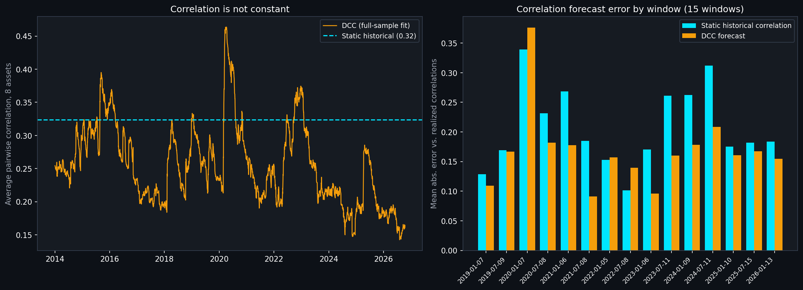
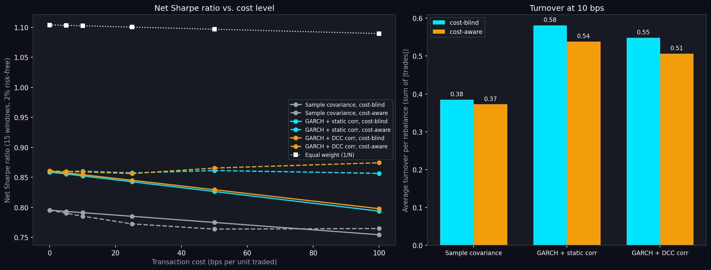
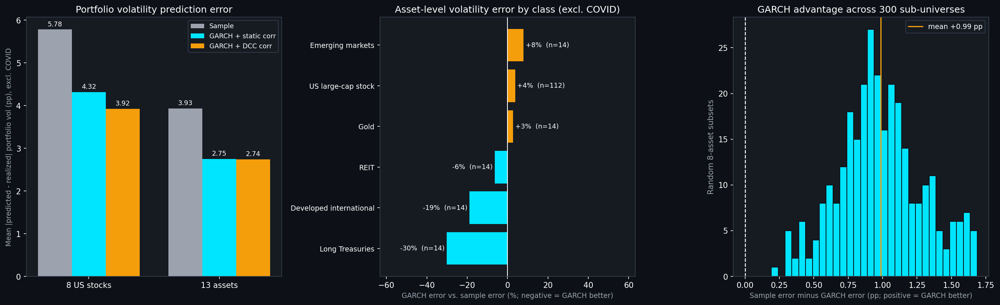
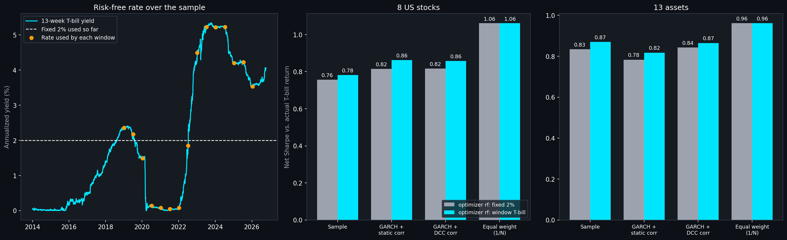
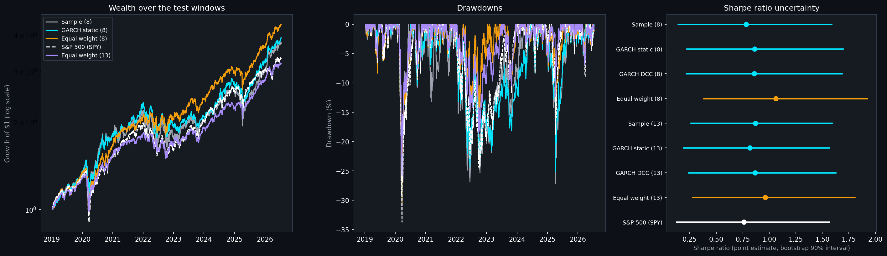

# Portfolio Optimization: Markowitz Theory with GARCH-Informed Risk
### Built on Real Market Data
**Ramith Vaid | NTU Singapore | Data Science & Artificial Intelligence**

---

## Overview

Standard Markowitz portfolio theory builds an efficient frontier from a single, fixed historical covariance matrix. This project starts from the same textbook foundation, then asks a question the textbook version usually skips: where does the risk estimate driving the whole optimization actually come from, and does a more responsive risk estimate lead to a meaningfully better portfolio?

A baseline efficient frontier is built from a standard sample covariance matrix. A second covariance matrix is then constructed using GARCH(1,1) conditional volatility forecasts, reusing the from-scratch implementation built for the companion volatility forecasting project, combined with historical correlations, an approach related to the Constant Conditional Correlation GARCH framework (Bollerslev, 1990). The two resulting portfolios are compared directly, including a proper out-of-sample test of which risk estimate was actually more accurate.

**Asset universe:** 8 large-cap US stocks across financials, technology, energy, healthcare, consumer staples, industrials, utilities and consumer discretionary, chosen for sector diversification.

---

## Two Issues Caught and Fixed Before Trusting the Result

**Portfolio concentration.** An early version of this comparison let the optimizer allocate freely, and the GARCH-informed Max Sharpe portfolio concentrated 74% of its weight into a single stock. A result built on one concentrated bet doesn't actually test whether the covariance methodology is sound, it mostly tests whether that one stock happened to perform well. Fixed by capping any single position at 35% across every optimization, sample covariance and GARCH-informed alike.

**A single out-of-sample window is not enough to trust.** The first version of the validation tested both covariance approaches on one train/test split. Fixed by rolling the split forward across 9 separate, non-overlapping six-month windows spanning the full decade of data, and comparing average prediction error across all of them rather than relying on one snapshot.

---

## A Genuine Outlier, Identified and Handled Honestly

Running the validation across 9 windows surfaced something worth being upfront about rather than averaging away. One window, the period starting January 2020, showed prediction errors above 29% for both models, while every other window sat between roughly 1% and 12%. That window's test period runs directly into the February-March 2020 COVID crash, an extreme, genuinely unprecedented volatility event with no precedent in either model's training data.

Leaving that window in the headline number answers the wrong question, it mostly measures how badly both approaches handled an unforecastable shock, not which covariance method is more accurate under ordinary conditions. The notebook identifies this window explicitly (rather than silently dropping any inconvenient result) and reports both numbers: the full 9-window average, and the 8-window average with the crisis window excluded and clearly labelled as such.

---

## Pipeline

```
Yahoo Finance prices  --->  log returns  --->  Sample Covariance  --->  Efficient Frontier
                                                                              |
                                                                              v
                                              GARCH(1,1) per asset (from-scratch, reused    Max Sharpe /
                                              from the volatility forecasting project)  --->  Min Variance
                                                          |                                  Portfolios
                                                          v
                                              GARCH-Informed Covariance
                                              (GARCH volatility x historical correlation)
                                                          |
                                                          v
                                              Rolling 9-window out-of-sample validation
                                              (with the COVID-crash window identified and isolated)
```

---

## Key Findings

**Full-sample Max Sharpe portfolios differ meaningfully.** Using the full 10-year sample, the GARCH-informed covariance produces a Max Sharpe portfolio with an estimated volatility of 14.20%, versus 19.97% for the sample-covariance version, with noticeably different weights, GARCH shifts meaningful weight toward JPM and away from CAT and NEE, reflecting that JPM's current conditional volatility sits well below its 10-year historical average while several other names don't show the same gap.

**GARCH provides a genuinely better risk estimate under ordinary market conditions.** Excluding the one unforecastable crisis window, GARCH-informed covariance produced a 28.2% lower average prediction error than sample covariance (3.52% vs 4.90%), and was the more accurate approach in 5 of the 8 ordinary-condition windows. Part 4 qualifies how far this goes: it is a result about portfolio volatility, and for the volatility of individual assets GARCH is no better than the sample estimate in this data (see Part 4).

**Part 3 qualifies how far the GARCH result carries.** The finding above is about how well each covariance matrix *predicts portfolio volatility*. When the portfolios are instead scored on realized, net-of-cost performance (Part 3), the GARCH-informed portfolios have lower realized volatility than the sample-covariance one, but their return advantage is small and not statistically distinguishable, and a plain equal-weight portfolio beats all of the Max Sharpe portfolios over the same 15 windows. A better risk estimate did not, on this evidence, make a better portfolio than not optimizing at all.

**Neither approach handles a genuine tail event well, and that's an honest limitation of both, not a flaw specific to either.** Both models posted their worst error by a wide margin in the window whose test period included the COVID crash. This is reported explicitly rather than smoothed over.

---

## Known Limitations

**Correlation is static in the main analysis; Part 2 tests a dynamic alternative.** The GARCH-informed covariance matrix in the main analysis and Part 1 updates each asset's individual volatility dynamically but reuses the static historical correlation matrix. Part 2 adds a simple DCC-GARCH correlation estimate and compares the two (see below). The DCC used is the basic two-parameter version with a two-step estimator, shared by every pair of assets; richer variants (asset-specific dynamics, asymmetric terms, joint estimation) were not tried.

**Long-only; transaction costs are only modelled in Part 3, and as a simple proportional cost.** The main analysis and Parts 1 and 2 rebalance fresh at each window with no penalty for turnover. Part 3 adds a proportional cost per unit traded and a turnover penalty in the optimizer (see below). It does not model market impact, bid-ask spreads that vary by stock or period, taxes, or shorting costs, and the 10 bps headline is a round number, not a measured one.

**Few windows, even with more assets.** The rolling validation has 15 six-month windows, and excluding even one (the COVID crash) noticeably changes the picture. Part 4 widens the universe from 8 US stocks to 13 assets (adding a REIT, long Treasuries, developed and emerging international equity and gold), which adds assets and asset-level observations but not windows, so the portfolio-level conclusions still rest on 14 to 15 non-independent windows. A longer or higher-frequency dataset would be needed to change that.

---

## Part 1: Extended Date Range

The original run covered 2014 to 2024 across the same 8-asset universe. This extends it through October 2026 (3,214 trading days), giving 15 non-overlapping 6-month rolling windows instead of 9. The first 9 windows reproduce the original per-window errors exactly, confirming the refactor into `portfolio_utils.py` changed nothing about the underlying calculations.

The COVID window (test starting January 2020) is still the clear outlier, at 29.5% sample-covariance error -- nothing in the newly added period comes close; the next largest error anywhere in the sample is 10.0%.

Excluding COVID, GARCH-informed covariance keeps its edge over the extended sample, though the margin narrows slightly:

| | Original (8 windows) | Extended (14 windows) |
|---|---|---|
| Sample covariance, avg error | 4.90% | 5.78% |
| GARCH-informed, avg error | 3.52% | 4.32% |
| GARCH relative improvement | 28.2% | 25.4% |
| Windows won by GARCH | 5 of 8 | 10 of 14 |

Not every new window favors GARCH: the window testing from January 2025 is a clear loss for the GARCH-informed covariance (12.25% error vs. 5.44% for sample covariance) -- a reminder that the GARCH approach wins on average across windows, not in every one.

Full-sample Max Sharpe volatility is largely unchanged: 18.42% with sample covariance (was 19.97%) versus 14.48% GARCH-informed (was 14.20%).

---

## Part 2: Dynamic Correlation (DCC-GARCH) vs. Static Correlation

Part 1's covariance keeps each asset's GARCH volatility current but holds the correlation matrix fixed at its historical value. This adds a simple DCC-GARCH estimate (Engle 2002, two shared parameters `a` and `b`, estimated by the standard two-step method) so correlations can move too, and compares the two head-to-head. The implementation is in `portfolio_utils.py`; `part2_dcc_correlation.ipynb` runs the comparison on the same 8 assets, same 15 rolling 6-month windows and the same Part 1 data (end date pinned to 2026-10-13 so it reproduces).

The comparison is deliberately a one-variable change: the DCC covariance uses *exactly the same* per-asset GARCH volatilities as Part 1's "GARCH-informed" covariance (the notebook checks this), and only the correlation matrix differs, DCC forecast instead of static historical.

**Correlations do move, and persistently.** The full-sample fit gives `a` = 0.0095 and `b` = 0.9815 (`a + b` = 0.991): shocks to correlation are small but very long-lived. The average pairwise correlation across the 8 stocks ranges from 0.14 (August 2026) to 0.46 (April 2020, the COVID crash) against a single static value of 0.32. Today's correlation is well below the static average, so the DCC forecast for the next six months (0.20) is much lower than the static 0.32.

**DCC forecasts realized correlations better.** The cleanest test doesn't involve any portfolio: how far is each method's correlation matrix from the correlations actually realized over the next 6 months (mean absolute error across the 28 pairwise correlations)?

| | Static historical | DCC forecast |
|---|---|---|
| Mean correlation error, 15 windows | 0.208 | 0.168 |
| Windows closer to realized | 3 of 15 | 12 of 15 |

The improvement is consistent (paired t-statistic 3.1 over 15 windows) but it is not universal: DCC does worse in three windows, including the COVID window (Jan 2020 test start), where correlations spiked within the test period itself and neither method could have anticipated it.

**The portfolio-volatility effect is smaller and not statistically clear.** Using Part 1's metric, the average gap between a Max Sharpe portfolio's predicted and realized volatility:

| | All 15 windows | Excluding COVID window (14) |
|---|---|---|
| Sample covariance | 7.36% | 5.78% |
| GARCH + static correlation (Part 1) | 6.23% | 4.32% |
| GARCH + DCC correlation (Part 2) | 5.91% | 3.92% |

DCC has the lowest average error, and beats the static-correlation version in 10 of 15 windows (10 of 14 excluding COVID). But the improvement is about 0.3-0.4 percentage points against window-to-window standard deviations of about 4 to 9 points, and the paired t-statistics are only 1.1 (all windows) and 1.3 (excluding COVID), so with 15 windows this should be read as "consistent with a modest gain", not as proven. Excluding COVID, GARCH + DCC is 32% lower in error than sample covariance (3.92% vs. 5.78%), compared with 25% for the static-correlation version (4.32%).

There are five windows where GARCH with static correlation does worse than plain sample covariance. In four of them (Jan 2019, Jan 2020, Jan 2022, Jan 2025; GARCH errors of 7-33%) DCC doesn't help either, and both GARCH variants miss by about the same amount. That points to the volatility level, not the correlations, as the dominant error there, so the correlation model can't fix it. In the fifth (Jan 2021) DCC does fix it (3.1% down to 1.3%).

On the full sample, DCC changes the Max Sharpe weights modestly (JPM 35% to 29%, JNJ 4% to 7%, CAT 0% to 4%) and lowers the predicted volatility from 14.48% to 13.18%. That drop is a forecast of a lower-correlation regime, not evidence the portfolio would have been safer.



A note on a bug caught along the way: the first version of the DCC optimizer (SLSQP with a stationarity constraint) wandered outside the constraint in one window (`a + b` = 1.009), where the correlation process explodes and the likelihood becomes spuriously low, and that window then looked artificially good. The fit now uses a parametrization that guarantees `a + b < 0.999`, and the notebook asserts this holds in every window (the largest is 0.988).

---

## Part 3: Transaction Costs and Turnover

Parts 1 and 2 scored each covariance method by how well it predicted portfolio volatility. That says nothing about what it costs to act on the estimate, and Max Sharpe re-solved from scratch every six months can trade a lot. This adds a cost model, a turnover penalty in the optimizer, and a net-of-cost comparison of realized performance. The code is appended to `portfolio_utils.py`; `part3_transaction_costs.ipynb` runs it on the same 8 assets, same 15 rolling windows and same pinned data as Parts 1 and 2.

**Setup.** Every rebalance pays `cost x sum|w_new - w_drifted|`, a proportional cost on each unit of portfolio value traded, where `w_drifted` is last window's portfolio after it has drifted with the assets' returns (so turnover is measured against what is actually held). The optimizer's turnover penalty maximizes Sharpe on expected return net of the annualized cost of trading from the drifted holdings, with the same 35% cap. The headline cost is 10 bps per unit traded (a round number chosen in advance, not estimated), with 0, 5, 25, 50 and 100 bps as a sensitivity range. Window 1 starts fully invested with no entry cost for every strategy, so costs come from 14 rebalances. The treatment is applied on top of all three covariance methods (sample, GARCH + static correlation, GARCH + DCC correlation), each cost-blind (Parts 1 and 2's optimizer, which ignores cost when choosing but still pays it) and cost-aware (with the penalty), plus an equal-weight (1/N) portfolio as a reference, so the cost effect and the correlation-method effect are not mixed. Performance is computed from the concatenated daily returns of the 15 test windows (1,890 days), with the same 2% risk-free rate as the optimizer.

**Costs are small at realistic levels, and they do not change the ranking of covariance methods.** Max Sharpe trades a good deal each rebalance: average turnover (sum of absolute trades, 1.0 = trading the whole portfolio once) is 0.385 for sample covariance, 0.581 for GARCH + static and 0.549 for GARCH + DCC. At 10 bps that costs 0.085, 0.129 and 0.122 percentage points of return per year. Net of cost at 10 bps (cost-blind):

| | Net return | Volatility | Net Sharpe | Avg turnover | Cost drag per year |
|---|---|---|---|---|---|
| Sample covariance | 18.66% | 21.06% | 0.791 | 0.385 | 0.085 pp |
| GARCH + static corr | 19.12% | 20.08% | 0.852 | 0.581 | 0.129 pp |
| GARCH + DCC corr | 18.63% | 19.46% | 0.854 | 0.549 | 0.122 pp |
| Equal weight (1/N) | 21.67% | 17.85% | 1.102 | 0.114 | 0.026 pp |

The GARCH variants trade more than the sample covariance, so they pay more, but not enough to matter: gross Sharpe ratios are 0.795, 0.859 and 0.861 (sample, static, DCC), so the 10 bps cost takes roughly 0.004 to 0.007 off each. Even at 100 bps the cost-blind GARCH portfolios (net Sharpe 0.794 static, 0.798 DCC) stay ahead of the sample covariance (0.754). The GARCH-variant advantage is real in the point estimates (lower volatility, a Sharpe ratio about 0.06 higher), but it is not statistically clear: the mean per-window net-return difference of GARCH + static over sample is +0.217 percentage points with a paired t-statistic of 0.21 over 15 windows (positive in 9 of 15), and GARCH + DCC over sample is -0.017 points (t about 0). DCC against static correlation is -0.234 points (t = -1.25). So Part 2's small DCC advantage in volatility prediction does not show up as a return or Sharpe advantage.

**The turnover penalty is mostly a wash at realistic costs.** At 10 bps, cost-aware optimization cuts turnover (0.37, 0.54, 0.51 vs. 0.385, 0.581, 0.549) and moves net Sharpe by less than 0.01 either way (sample 0.785 vs. 0.791, static 0.860 vs. 0.852, DCC 0.859 vs. 0.854); paired t-statistics on the per-window net return difference are -0.84, +1.23 and +0.99. At 50 to 100 bps the cost-aware GARCH portfolios hold their net Sharpe (0.857 static, 0.874 DCC at 100 bps) where the cost-blind ones fall, but the DCC cost-aware portfolio's net return at 100 bps (19.29%) is higher than its zero-cost return (18.75%), so the improvement is larger than the trading cost it saved. That looks like the penalty damping the noisy mean-return signal, which dominates Max Sharpe weights (a position sits at the 35% cap in 14, 12 and 12 of 15 windows for sample, static and DCC), rather than a cost effect. For the sample covariance the penalty is slightly worse than cost-blind at most levels. The honest summary is that the turnover penalty is cheap insurance against high costs and nothing more.

**The bigger result is the equal-weight reference, and it qualifies the project's headline.** A plain 1/N portfolio, rebalanced each window, has a net Sharpe of 1.102 against 0.791 to 0.854 for the Max Sharpe portfolios, a higher net return (21.67% vs. 18.63% to 19.12%) and the lowest volatility (17.85%), while trading far less (turnover 0.114). The per-window return gaps are not statistically distinguishable (mean -1.15 and -1.17 percentage points per window for sample and GARCH + DCC against 1/N, t = -0.78 and -0.85, 1/N better in 8 and 9 of 15 windows), so this is not a proven win for 1/N either, but the sign is consistent across every cost level. Taken with Parts 1 and 2, what the project has shown is that GARCH and DCC give a better *risk* estimate than the sample covariance, and that a Max Sharpe optimizer fed that estimate and 5-year mean returns did not turn it into a better-performing portfolio than not optimizing. Two things stack the comparison in 1/N's favor and should be kept in mind: the 8 stocks are today's large-cap leaders, chosen with hindsight over a period when they did well, and Max Sharpe is the most mean-return-sensitive optimizer there is, so the result says more about mean-return estimation than about the covariance methods.



---

## Part 4: Beyond Eight US Stocks

The analysis so far used eight US large-cap stocks. Part 4 adds five ETFs, Vanguard Real Estate (VNQ), iShares 20+ Year Treasury (TLT), iShares MSCI EAFE (EFA), iShares MSCI Emerging Markets (EEM) and SPDR Gold (GLD), for 13 assets, with the same 15 rolling windows, 35% cap and pinned data. The average pairwise correlation falls from 0.32 to 0.28. `part4_expanded_universe.ipynb` makes four comparisons; the per-window estimates for both universes are cached in git-ignored pickles that later parts reuse (`load_or_build_window_inputs` in `portfolio_utils.py`).

**Portfolio level: errors fall with the wider universe, and the GARCH advantage survives.** Mean absolute gap between the volatility a Max Sharpe portfolio's covariance predicted and the volatility realized over the next six months, excluding the COVID window:

| | Sample | GARCH + static corr | GARCH + DCC corr |
|---|---|---|---|
| 8 US stocks (14 windows) | 5.78% | 4.32% | 3.92% |
| 13 assets (14 windows) | 3.93% | 2.75% | 2.74% |

GARCH with static correlation has the lower error than the sample covariance in 10 of 15 windows (8 stocks) and 11 of 15 (13 assets), and the paired t-statistic excluding COVID is 1.46 and 1.50, so it is consistent with an advantage but not statistically clear in either universe. DCC's edge over static correlation, visible with 8 stocks, is gone with 13 (2.74% vs. 2.75%).

**Asset level: GARCH is not a better volatility forecast on average.** Over the 195 asset-windows (13 assets x 15 windows), the GARCH volatility at the end of the training window is closer to the next six months' realized volatility than the sample volatility in 52% of them, with a mean error of 6.59% against 6.52% (4.93% against 4.94% excluding COVID, 54% closer, t = 0.03). The observations are not independent (assets move together and windows are adjacent), so these are indicative. The picture differs by asset class (excluding COVID, GARCH error relative to sample error): long Treasuries -30%, developed international equity -19%, REITs -6%, but emerging markets +8%, US large-cap stocks +4% (112 asset-windows, 5.48% vs. 5.28%) and gold +3%. Within the 8 stocks, GARCH is better for PG, JNJ and JPM and worse for AAPL, AMZN, NEE and CAT. So the portfolio-level result in Part 1 is not explained by a better single-asset volatility forecast; why the portfolio-level error is lower was not isolated here.

**Random sub-universes.** In 300 random 8-asset subsets of the 13 (GARCH with static correlation against sample covariance), GARCH has the lower average error in every one, by 0.99 percentage points on average (5th to 95th percentile 0.46 to 1.54). The advantage is larger with fewer non-stock assets (+1.47 points with none, +0.99 with three, +0.57 with five). All 300 subsets draw on the same 14 windows, so this shows the advantage is not specific to one set of eight stocks, not that there are 300 independent confirmations.

**Net performance: the Part 3 Sharpe edge for GARCH does not carry over.** Cost-blind Max Sharpe net of 10 bps, 2% risk-free rate as in Part 3:

| | Sample | GARCH + static corr | GARCH + DCC corr | Equal weight |
|---|---|---|---|---|
| 8 US stocks, net Sharpe | 0.791 | 0.852 | 0.854 | 1.102 |
| 13 assets, net Sharpe | 0.883 | 0.832 | 0.892 | 1.012 |

With 13 assets GARCH with static correlation has a lower net Sharpe than the sample covariance (0.832 vs. 0.883), DCC is about level with it (0.892), and equal weight is again the best (1.012, with a turnover of 0.10 against 0.41 to 0.66 for the optimized portfolios). A Max Sharpe portfolio holds a median of 5 or 6 of the 13 assets and has a position at the 35% cap in 10 to 12 of the 15 windows. The small Sharpe edge for GARCH-informed covariance seen with 8 stocks in Part 3 was specific to that universe.



## Part 5: A Time-Varying Risk-Free Rate

The optimizer and every Sharpe ratio so far used a fixed 2% risk-free rate. The 13-week Treasury bill yield (`^IRX`) averaged 1.92% over the sample but ran from about 0% (2014 to 2015, 2020 to 2021) to 5.35% (2023 to 2024). The rate enters twice, and `part5_risk_free.ipynb` changes each separately. In the optimizer, each window uses the T-bill yield on its last training day (0.04% to 5.22% across the 15 windows) instead of 2%. In measurement, Sharpe is also computed against the T-bill return actually earned over the same days (geometric return minus the compounded T-bill return, over volatility). Everything else is as in Part 3: net of 10 bps costs, cost-blind Max Sharpe, 35% cap, both the 8-stock and the 13-asset universe from Part 4.

**Measurement matters more than the optimizer.** Over the test windows the T-bill compounded to 2.74% a year, 0.74 points above the assumed 2%, so every Sharpe ratio computed against 2% is too high: by 0.035 to 0.041 with 8 stocks and 0.049 to 0.051 with 13 assets. For example, equal weight on 8 stocks has a net Sharpe of 1.102 against 2% and 1.061 against the T-bill. The Part 3 and Part 4 figures are the first kind; this part's are the second.

**In the optimizer, the rate changes the portfolio only a little.** Full-sample Max Sharpe weights (8 stocks, GARCH covariance) move by 2.8 percentage points in total between a 0% and a 2% rate and by 7.2 between 2% and 5%; JPM and AAPL stay at the 35% cap and NEE stays near 23.5% at all three. In the rolling comparison the share of the portfolio that differs between the fixed-rate and T-bill-rate versions averages 2% to 5% per window (at most 16%), and almost no window is identical. Using each window's own rate raises net Sharpe against the T-bill for every optimized strategy:

| Net Sharpe vs. T-bill | Sample | GARCH + static corr | GARCH + DCC corr | Equal weight |
|---|---|---|---|---|
| 8 US stocks, fixed 2% in the optimizer | 0.756 | 0.816 | 0.816 | 1.061 |
| 8 US stocks, window T-bill in the optimizer | 0.782 | 0.862 | 0.857 | 1.061 |
| 13 assets, fixed 2% | 0.834 | 0.783 | 0.842 | 0.962 |
| 13 assets, window T-bill | 0.870 | 0.817 | 0.865 | 0.962 |

The gains (0.023 to 0.047) are about the size of the differences between the covariance methods themselves, over 15 windows of which the rate regime changes in only a few, so they should be read as small and untested, not as a reason to prefer the time-varying rate. Equal weight does not use the rate and is the best strategy in every row. The ordering of the optimized strategies is stable with 8 stocks (both GARCH variants above the sample covariance under either rate). With 13 assets it depends on the rate: DCC, then sample, then static correlation with the fixed rate; sample, DCC, then static with the T-bill rate.



## Part 6: Benchmarks

Part 3 used equal weight as a reference. Part 6 compares the Max Sharpe strategies (the Part 5 versions: window T-bill in the optimizer, net of 10 bps, sample, GARCH with static correlation, GARCH with DCC correlation) against equal weight of the same assets, rebalanced each window, and against S&P 500 buy-and-hold (SPY, total return), over the same 1,890 days (January 2019 to July 2026), for the 8-stock and the 13-asset universe. `part6_benchmarks.ipynb` adds drawdowns, window-by-window counts, a CAPM regression on SPY with a Newey-West covariance, and a block bootstrap (5,000 resamples in 21-day blocks, the same blocks for every strategy) for the Sharpe ratios. The helpers (`risk_summary`, `drawdown_path`, `capm_regression`, `bootstrap_sharpe_differences`) were added to `portfolio_utils.py`. Sharpe ratios are against the T-bill return actually earned, as in Part 5.

| | Return | Vol | Sharpe | Max drawdown | Calmar |
|---|---|---|---|---|---|
| S&P 500 (SPY) | 17.5% | 19.4% | 0.760 | -33.7% | 0.52 |
| 8 stocks: Sample | 19.3% | 21.1% | 0.782 | -28.1% | 0.69 |
| 8 stocks: GARCH static | 20.0% | 20.1% | 0.862 | -30.0% | 0.67 |
| 8 stocks: GARCH DCC | 19.5% | 19.6% | 0.857 | -30.2% | 0.65 |
| 8 stocks: equal weight | 21.7% | 17.8% | 1.061 | -30.5% | 0.71 |
| 13 assets: Sample | 15.7% | 14.9% | 0.870 | -23.0% | 0.68 |
| 13 assets: GARCH static | 14.8% | 14.7% | 0.817 | -23.5% | 0.63 |
| 13 assets: GARCH DCC | 15.5% | 14.7% | 0.865 | -22.6% | 0.69 |
| 13 assets: equal weight | 16.8% | 14.6% | 0.962 | -25.9% | 0.65 |

**The optimized portfolios are only slightly ahead of the index, and equal weight is ahead of both.** The Max Sharpe portfolios on 8 stocks have a Sharpe of 0.78 to 0.86 against 0.76 for SPY, and they drew down 28% to 30% against SPY's 34%. Equal weight of the same 8 stocks has the highest return, the highest Sharpe (1.061) and the best Calmar ratio. Adding the five non-stock assets cuts volatility to about 14.7% and the maximum drawdown to 23% to 26%, with a lower return, so the 13-asset portfolios have a similar Sharpe ratio to the 8-stock optimized ones and a shallower drawdown than SPY. Beta to SPY is 0.83 to 0.92 for the 8-stock strategies and 0.57 to 0.69 for the 13-asset ones.

**Evidence about which is better is weak.** Over single six-month windows, the optimized 8-stock portfolios beat SPY in 7 to 11 of 15 windows and equal weight does in 8; the optimized 13-asset portfolios beat SPY in 6 to 8. Only equal weight on 8 stocks has a CAPM alpha with a t-statistic above 2 (5.9% a year, t = 2.24); the Max Sharpe strategies' alphas are 3% to 4% with t-statistics between 0.7 and 1.1 (8 stocks) and 1.0 to 1.3 (13 assets). In the bootstrap, each strategy's Sharpe ratio has a 90% interval about 1.4 wide (for example 0.14 to 1.59 for the 8-stock sample covariance and 0.38 to 1.92 for equal weight). The probability that an optimized strategy's Sharpe ratio exceeds equal weight's is 11% to 34%, and that it exceeds SPY's is 52% to 66%. Equal weight on 8 stocks exceeds SPY in 96% of resamples (median Sharpe difference +0.30, 90% interval +0.02 to +0.62), and on 13 assets in 88% (median +0.20, interval -0.09 to +0.50). So equal weight is the best point estimate and probably better than the index, while the Max Sharpe portfolios cannot be told apart from SPY or from each other. The same caveats as before apply: 15 windows, one period, and universes of today's large caps and ETFs picked with hindsight.



---
## Files

- `portfolio_optimization.ipynb` -- the original 2014-2024 notebook, left untouched.
- `portfolio_utils.py` -- the Markowitz and GARCH-covariance functions factored out of the original notebook (bodies unchanged), plus `run_rolling_validation()` to run the rolling-window comparison on any date range.
- `part1_extended_period.ipynb` -- Part 1: the same analysis through October 2026, using `portfolio_utils.py`.
- `chart_extended_rolling_windows.png` -- per-window prediction error, sample vs. GARCH-informed covariance, extended period.
- `part2_dcc_correlation.ipynb` -- Part 2: DCC vs. static correlation head-to-head (the DCC functions were added to `portfolio_utils.py`).
- `chart_part2_dcc.png` -- DCC average correlation over time, and correlation forecast error by window.
- `part2_rolling_dcc_comparison.csv` -- the per-window numbers behind the Part 2 tables.
- `part3_transaction_costs.ipynb` -- Part 3: cost model, turnover penalty and net-of-cost comparison (the cost functions were added to `portfolio_utils.py`).
- `chart_part3_transaction_costs.png` -- net Sharpe ratio vs. cost level for every strategy, and turnover at 10 bps.
- `part3_cost_comparison_10bps.csv`, `part3_cost_sensitivity.csv`, `part3_paired_comparisons.csv`, `part3_turnover_by_window.csv` -- the numbers behind the Part 3 tables.
- `part4_expanded_universe.ipynb` -- Part 4: 8 US stocks vs. 13 assets at portfolio level, asset level and across 300 random sub-universes (`load_or_build_window_inputs` was added to `portfolio_utils.py`; the per-window estimates are cached in git-ignored `cache_window_inputs_*.pkl` files).
- `chart_part4_universe.png` -- portfolio volatility error by universe, asset-level error by class, and the GARCH advantage across random sub-universes.
- `part4_portfolio_vol_errors.csv`, `part4_window_errors.csv`, `part4_net_performance.csv`, `part4_asset_vol_errors.csv`, `part4_random_subsets.csv` -- the numbers behind the Part 4 tables.
- `part5_risk_free.ipynb` -- Part 5: fixed vs. time-varying risk-free rate in the optimizer and in the Sharpe ratio (`window_risk_free`, `simulate_strategy_rf` and `performance_vs_risk_free` were added to `portfolio_utils.py`).
- `chart_part5_risk_free.png` -- the T-bill yield with each window's rate, and net Sharpe against the T-bill return.
- `part5_risk_free_comparison.csv`, `part5_weight_differences.csv`, `part5_window_rf.csv`, `part5_fullsample_weights_by_rf.csv` -- the numbers behind the Part 5 tables.
- `part6_benchmarks.ipynb` -- Part 6: the strategies against equal weight and S&P 500 buy-and-hold, with drawdowns, a CAPM regression and a block bootstrap of the Sharpe ratios.
- `chart_part6_benchmarks.png` -- wealth paths, drawdowns and Sharpe intervals.
- `part6_benchmark_summary.csv`, `part6_window_comparison.csv`, `part6_window_returns.csv`, `part6_capm.csv`, `part6_bootstrap_sharpe.csv` -- the numbers behind the Part 6 tables.

---

## Stack

- **Language:** Python 3.13
- **Libraries:** pandas, numpy, scipy, yfinance, matplotlib
- **Data source:** Yahoo Finance (free, no API key required)
- **GARCH implementation:** custom, via scipy.optimize, shared with the companion volatility forecasting project

---

## Relation to the Volatility Forecasting Project

This project reuses the exact GARCH(1,1) implementation built and validated in the companion [volatility forecasting project](https://github.com/ramith001/volatility-forecasting), applied here as the risk input to an actual portfolio construction problem rather than evaluated on its own. The two together form a complete story: first build and validate a model of risk, then use that risk model to construct something real, an optimal portfolio.

---

*Built by Ramith Vaid | NTU Singapore | ramithvaid@gmail.com*
